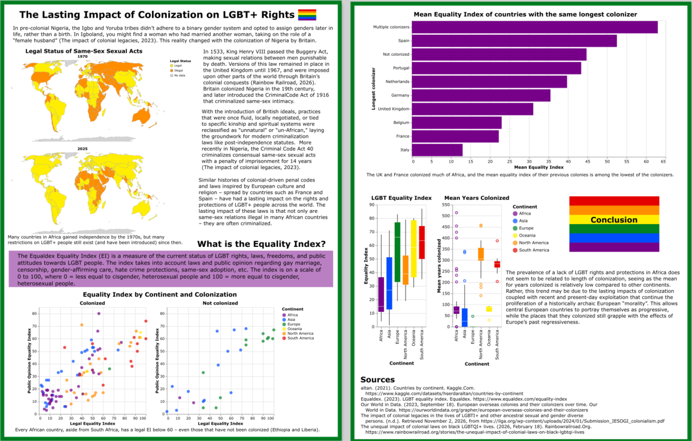

# The Lasting Impact of Colonization on LGBT+ Rights

Ashanti Hatchett

## Description

This project compares countries' colonial histories with the to the status of their LGBT rights,  as measured by the Equaldex Equality Index (detailed below). My goal was to find whether a countries' longest colonizer or length of colonization had any impact on their LGBT+ laws, restrictions, and public opinion today.

## Data Sources

### Equaldex

URL: https://www.equaldex.com/equality-index 

The Equaldex Equality Index (EI) is a measure of the current status of LGBT rights, laws, freedoms, and public attitudes towards LGBT people. The index takes into account laws and public opinion regarding gay marriage, censorship, gender-affirming care, hate crime protections, same-sex adoption, etc. The index is on a scale of 0 to 100, where 0 = less equal to cisgender heterosexual people and 100 = more equal to cisgender heterosexual people.

### Equaldex: Gender marker can be legally changed

URL: https://ourworldindata.org/grapher/right-to-change-legal-gender-equaldex

This dataset includes data from as early as 1950 to 2026, stating whether people in that country have the right to change their legal gender.

### Equaldex: Marriage for same-sex partners

URL: https://ourworldindata.org/grapher/marriage-same-sex-partners-equaldex

This dataset includes data from as early as 1950 to 2026, stating whether same-sex marriage is legal. 

### European overseas colonies and their colonizers over time

URL: https://ourworldindata.org/grapher/european-overseas-colonies-and-their-colonizers

This dataset includes the colonial histories of each country for each year (as early as 1462) until 2022. It states what country they were colonized by, or if they were a colonizer in that year.

### Countries by continent

URL: https://www.kaggle.com/datasets/hserdaraltan/countries-by-continent

This data includes a list of the countries in the world and the continents where they are located as of 2021.
