# LGBT Rights and Colonial History

Ashanti Hatchett

## What is your current goal? Has it changed since the proposal?
My current goal is to compare countries' longest colonizer and years of colonization to the status of their LGBT rights. In doing so, I hope to glean whether certain countries' have previous colonies that have particularly regressive LGBT rights (or lack thereof). In the proposal, I wasn't decided between comparing colonial histories or political makeup, so my goal has changed a bit since then.

## Are there data challenges you are facing? Are you currently depending on mock data?
There are various parts of my visualizations where the value on the x-axis or in the color legend is `null`, which I believe is due to the way that I created the `Longest colonizer` and/or `Years colonized` columns. So, I need to rememdy that.

## Describe each of the provided images with 2-3 sentences to give the context and how it relates to your goal.

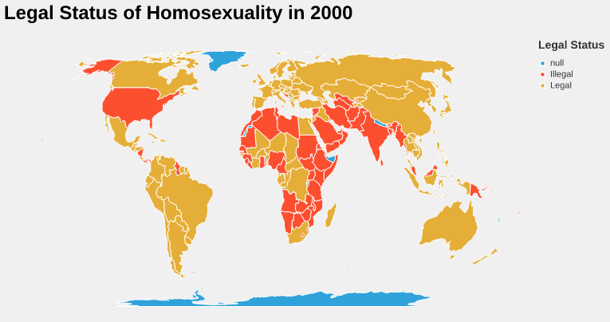

This choropleth shows the legal status of homosexuality in each country in 2000. In my narrative, this will be compared to a similar chart for 2025 to show the progression of the legality of homosexuality across the world in this century.

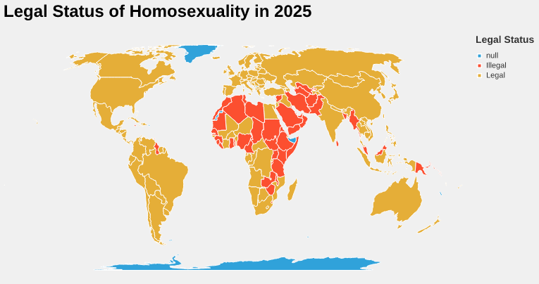

This choropleth shows the legal status of homosexuality in each country in 2025. In my narrative, this chart can be compared to the previous chart and a few succeding choropleths to understand how other legal rights of LGBT people have progressed in relation to the legal status of homosexuality.

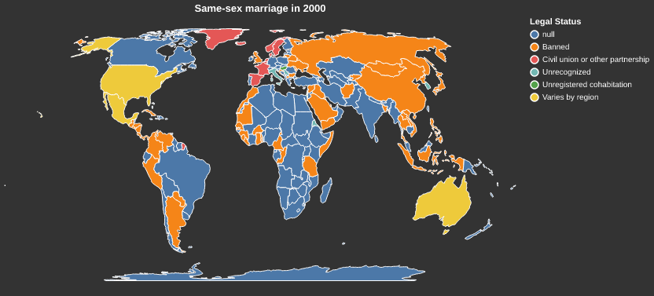

This choropleth displays the legality of same-sex marriage in each country in 2000. This can be compared to the surrounding choropleths to see the progression of LGBT rights in this century.

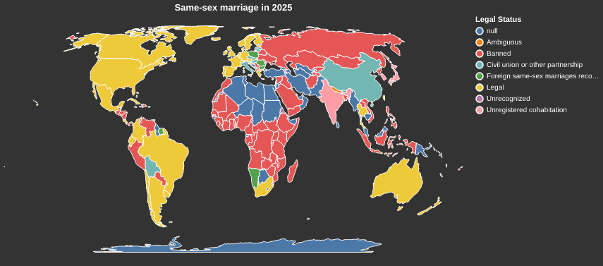

This choropleth displays the legality of same-sex marriage in each country in 2025. This can be compared to the surrounding choropleths to see the progression of LGBT rights in this century.

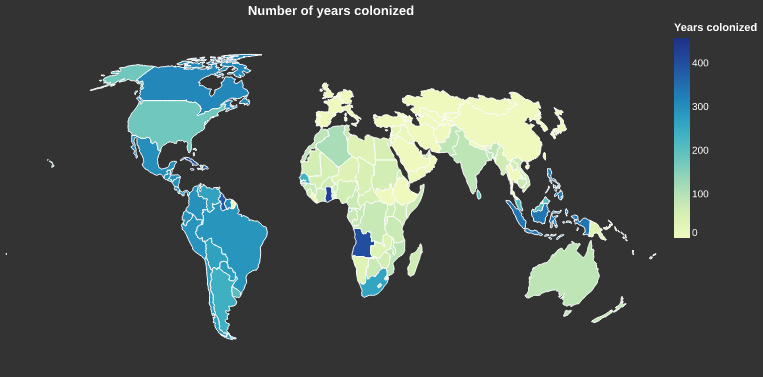

This choropleth shoes the number of years that each country was colonized. This can be compared to the proceeding choropleths to compare the number of years a country was colonized to its progression of rights for same-sex couples.

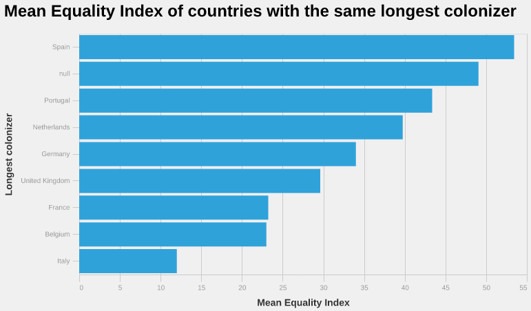

This bar chart displays the mean equality index (from Equaldex) of the countries with the same longest colonizer, or the colonizer that made up the largest proportion of their years colonized. In this chart, you can directly compare the mean equality index scores across countries with different colonizers.

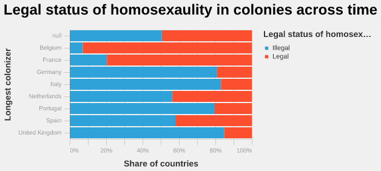

This bar chart includes all of the observations of the legal status of homosexuality across time by longest colonizer. But, initially this chart was a majority null values, which I suspect is because many of the countries that have colonization data don't have as much data about their LGBT policies, or their historical data doesn't go back as far. I worry that removing the null values makes this chart misleading.

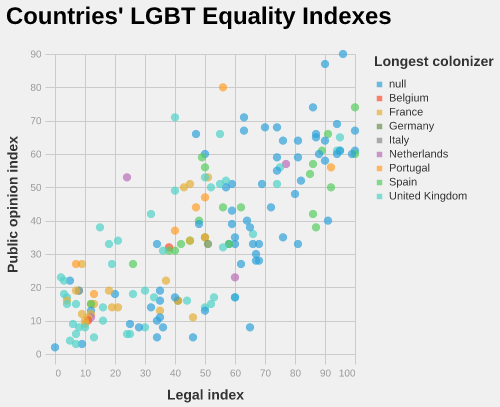

This scatter plot displays countries' equality indexes (both public opinion and legal), colored by their longest colonizer. This chart moves the narrative by including public opinion -- whereas the other charts mainly focus on the legal rights of LGBT people.

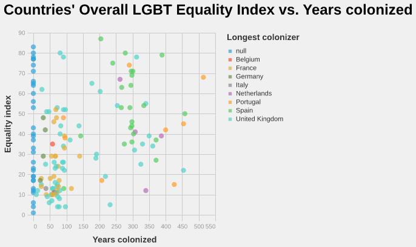

This scatter plot directly compares years colonized to equality index, colored by longest colonizer. Here, you can see which countries tended to colonize for longer, as well as the status of their past colonies' LGBT equality.

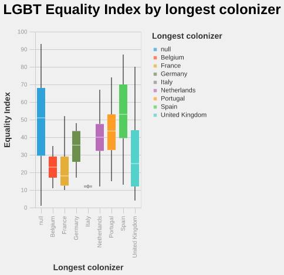

This box and whisker plot shows the distribution of equality indexes by the longest colonizer. I think this more clearly shows the mean of colonies' who have the same longest colonizer.

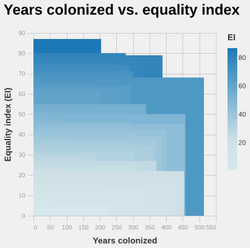

This heatmap compares years colonized to current equality index. It progresses the narrative by providing another way to directly compare equality index to years colonized.

## What form do you envision your final narrative taking? (e.g. An article incorporating the images? A poster? An infographic?)

I envision my final narrative taking the form of an article incorporating the images.